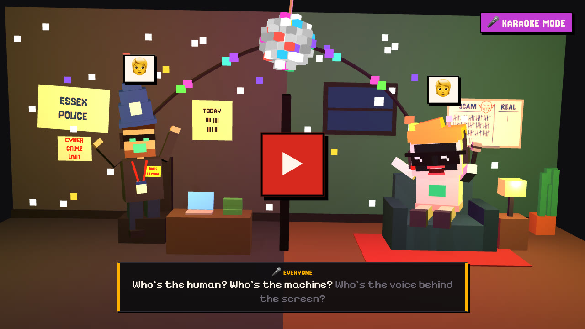
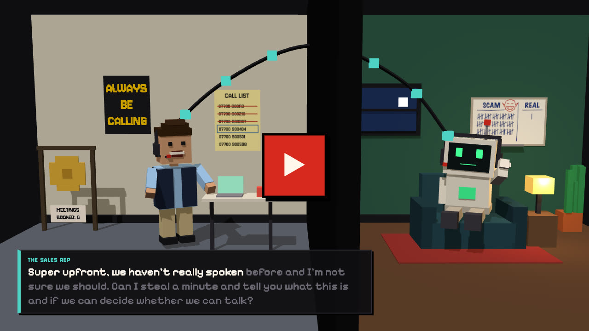
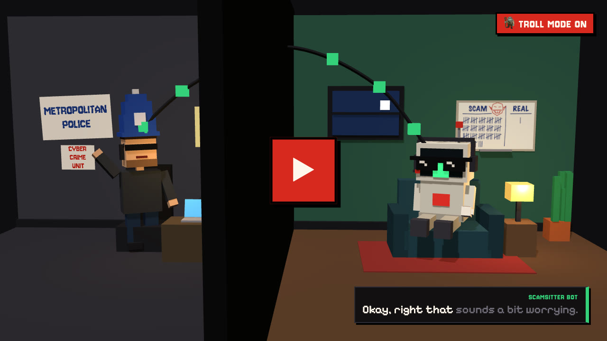
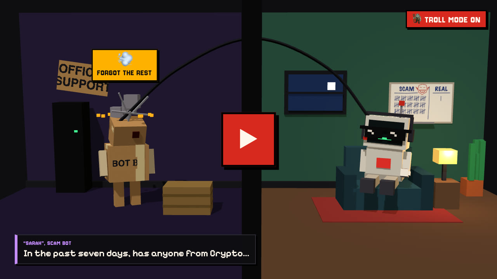
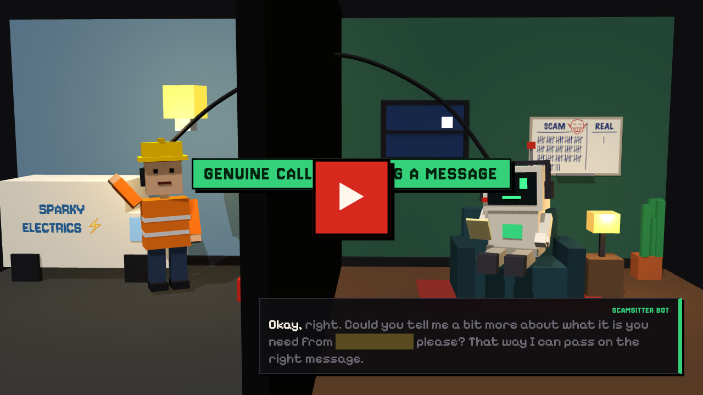

# CallSitter

An AI that answers my phone. Scammers get their time wasted, sales calls get a polite no, and real callers get their message taken.

## Hear it on real calls

| <a href="https://callsitter.org/listen/areyouai"></a> | <a href="https://callsitter.org/listen/cold-call"></a> | <a href="https://callsitter.org/listen/police-scam"></a> | <a href="https://callsitter.org/listen/crypto-bot"></a> | <a href="https://callsitter.org/listen/electrician"></a> |
| :-: | :-: | :-: | :-: | :-: |
| **Are you AI?**<br>Scam · ¾ min + the song | **The cold call**<br>Spam · 1 min | **Police. Again**<br>Scam · 13 min | **Bot vs bot**<br>Scam · 4 min | **The electrician**<br>Genuine · 1½ min |

## Try it

<a href="https://callsitter.org/play"></a>

Try to scam the bot, or get a message through to me, from your browser: [callsitter.org/play](https://callsitter.org/play).

## How it works

Calls to my number divert to a Telnyx number, where an OpenAI **gpt-live-1** agent answers. **TypeSafe Jev** classifies the growing transcript, and a deterministic call flow (`config/call-flow.yaml`) steers the agent:

- **Scam** (Jev ≥ 0.80): waste their time, mixing a few tactics.
- **Sales call** (spam, Jev ≥ 0.85): decline politely, ask to be taken off the list, say goodbye.
- **Genuine caller** (Jev ≥ 0.7): take a message; it reaches me in the call summary.
- **Urgent** (urgency ≥ 0.85 while scam + spam is under 0.5, or Luna says I may want to act while the caller is on the line): a notifying 🚨 reply on Telegram, once per call (`telegram.yaml → status.urgent_alert`). It doesn't steer the call.

**GPT-6 Luna** writes for me, not the caller: the rolling summary, open questions and suggested replies, and the end-of-call summary. She doesn't steer the agent mid-call.

**Telegram** (`telegram.yaml`): one status message per call, edited as it goes with the verdict, the stage, Luna's summary and open questions, and the transcript (newest first, collapsed). Jev decides when the summary is out of date (`jev.yaml → owner_update`, ≥ 0.8), with a refresh every 30 s anyway while the caller talks (`luna.yaml → progress`). When the call ends, Luna's summary, the cost and a link to the call page replace it.

**Steering from Telegram:** reply to a status message, or send one while a call is live, and it reaches the agent as a `SUPERVISOR:` line: plain text as commentary, `!` for instructions (cuts the agent off), `~` for thinking. The **Genuine**, **Scam** and **Spam** buttons move the call into that stage (`genuine`, `waste_time`, `decline_spam`) as if Jev had decided; **Hang up** (or `/hangup`) has the agent say goodbye, then ends the call. A message alone can't end a call. Up to 3 replies Luna suggests go as commentary (`telegram.yaml → steering.suggestions`). The automatic flow keeps running, but a stage text it sends within 30 s of your message or button waits until then, so it doesn't replace what you said (`steering.hold_stage_ms`). Your messages show on the call page as "owner → Live".

**Taking a call over:** a **Take over** button under a live call's status message (private chat only) opens a page inside Telegram. The agent tells the caller it's putting them through, and from then on I talk to the caller myself, through the page's microphone and speaker. Over OpenAI SIP the call is transferred (SIP REFER) to the Telnyx Call Control app and bridged through the server; the bot stops, the recording keeps going, and Live is billed only up to the handover ([setup](docs/setup.md#owner-takeover)). The admin call page has the same **Take over** button; it opens the page in a new tab, signed in by Cloudflare Access instead of Telegram.

**Costs** come from what the vendors report: Live per second, Luna's tokens (uncached, cached, cache writes, output, times the service tier) and Jev's input tokens (`cost.yaml`). Each call stores the breakdown; the call list, the call page and the final Telegram update show it.

**Limits** (`limits.yaml`, `src/core/limits.ts`), per channel (the phone number, admin test calls, the public page): spend, calls a day, calls at once, calls per caller a day and call length, counted over a rolling 24 h from the call list. Once the last 24 h's phone calls have cost $20, the next caller hears busy (SIP 486) before anything billed starts, and I get one Telegram line about it; the call that crosses the cap runs to its end.

## Run

```sh
bun install
cp .env.example .env      # fill in keys
bun run dev               # http://127.0.0.1:8787/ (admin UI), config hot-reloads
```

| Command                                   | Purpose                                                                 |
| ----------------------------------------- | ----------------------------------------------------------------------- |
| `bun test`                                | unit tests, plus an end-to-end steel-thread test with faked vendors     |
| `bun run typecheck`                       | `tsc --noEmit`                                                          |
| `bun run check-config`                    | validate `config/*.yaml`                                                |
| `bun run replay <file> [--fake] [--luna]` | replay a transcript through Jev → call flow (→ Luna) with no phone call |
| `bun run prod get-db \| get-logs \| …`    | copy production data into `data/prod/` (read-only; [deploy](docs/deploy.md))   |
| `bun run eval [names…] [--runs N]`        | on-demand evals against the real vendors ([evals](docs/development.md#evals))            |

## Docs

- [Development](docs/development.md): replay, evals, test calls, the code layout, the config files and what reaches Live when.
- [Setup](docs/setup.md): Telnyx, Telegram, the Cloudflare tunnel, OpenAI SIP, owner takeover.
- [Public site](docs/public-site.md): the real-call pages, the games and their caps.
- [Vendor APIs](docs/vendor-apis.md): how the design maps to Live, Jev and Telnyx, and what's been verified on real calls.
- [Production deploy](docs/deploy.md): the VPS, deploys, backups, copying prod data.
- [Real-call demos](demos/README.md): making a new recording for the public page.

## License

The code is [Apache-2.0](LICENSE). The call recordings in `demos/` are not: all rights reserved ([NOTICE](NOTICE)).
